## A Brief Introduction

The Crosman 1701P Silhouette is a PCP air pistol built for silhouette competition. Its **quiet report, accuracy with my preferred setup, and roughly 32 consistent shots per fill** make it enjoyable to shoot. The simple shape appeals to me, too. Loading can be fiddly, though, and the grips leave room for improvement—details that matter once I start shooting.

## Appearance and Build

The slim barrel, exposed reservoir, and angular breech give the 1701P a clean, purposeful look. Fine machining lines and a silver-colored trigger add detail, while my wooden grips bring some warmth to the dark metalwork.

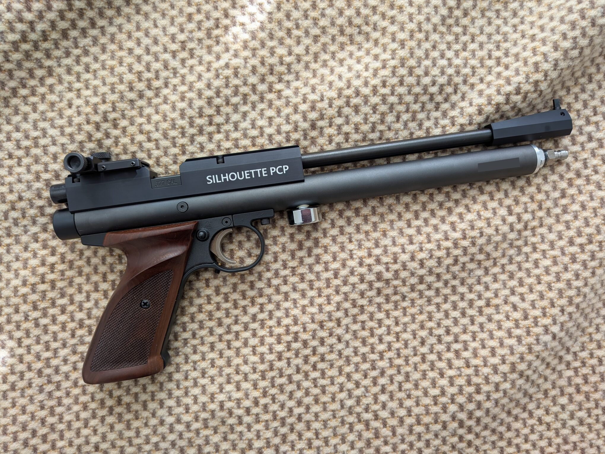

## Key Features and My Setup

Crosman describes the 1701P as a .177, single-shot, bolt-action PCP pistol with a reversible bolt. Its published length is 14.75 inches and factory weight is 2.8 lb; I have not weighed my equipped pistol.

The **Lothar Walther barrel** is a key factory feature for accuracy. [Crosman describes the German-made precision barrel as providing consistent accuracy](https://www.crosman.com/product/crosman-1701p-silhouette-competition-pcp-air-pistol-177-caliber/)—a useful strength when aiming at small silhouette targets.

I made two changes to the factory setup:

- [Wooden grips](#grip-ergonomics-and-balance): I replaced the original black plastic panels with the checkered wooden grips shown in my photos.
- [Williams rear sight](#williams-rear-sight): The pistol comes without a rear sight. I added the Williams adjustable sight to keep the setup lightweight for open-sight silhouette competition.

### Filling and the Pressure Gauge

The [owner's manual](https://support.crosman.com/hc/en-us/article_attachments/201669374/1701P-515.pdf) specifies a 3,000 psi maximum fill pressure. The fill connection sits beneath a removable cap at the front of the reservoir. I like how easily it connects to my air pump: the **male quick-disconnect (QD)** connects to the female QD on my pump hose directly.

I also like the **downward-facing pressure gauge**: I can read it from underneath the pistol without putting my face in front of the muzzle. It is a thoughtful design detail.

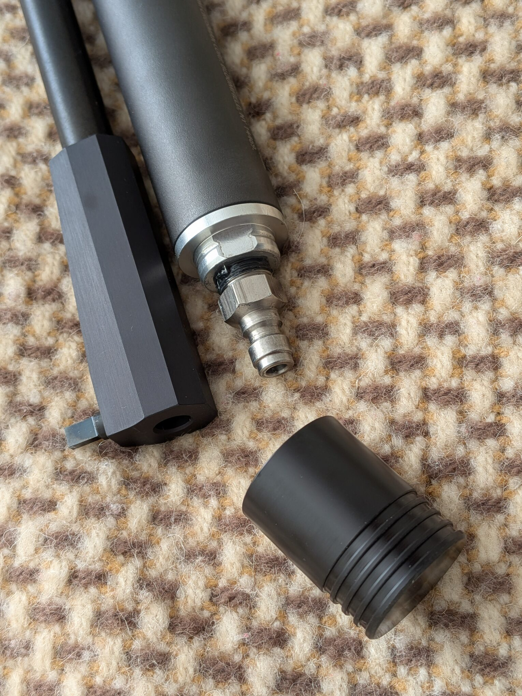

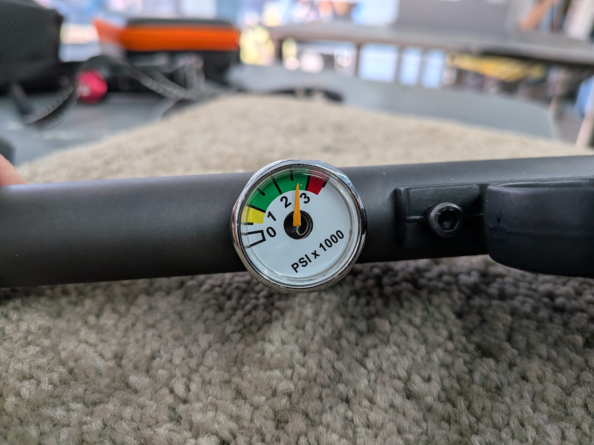

With the pistol's relatively small reservoir, **fill slowly when using a large air tank** and watch the pressure closely. On the other hand, rapid filling generates heat that can affect the pressure reading.

In my tests, starting fills right above 2,250 psi have worked well with JSB Exact 8.44-grain pellets, giving about 32–34 consistent shots around 445–455 fps. See chapter [Chronograph Results](#chronograph-results).

## Grip, Ergonomics, and Balance

The wooden grips I fitted have checkered panels and a pronounced ledge near the top. The photograph below shows them on the pistol beside the original black plastic grip panels from the factory.

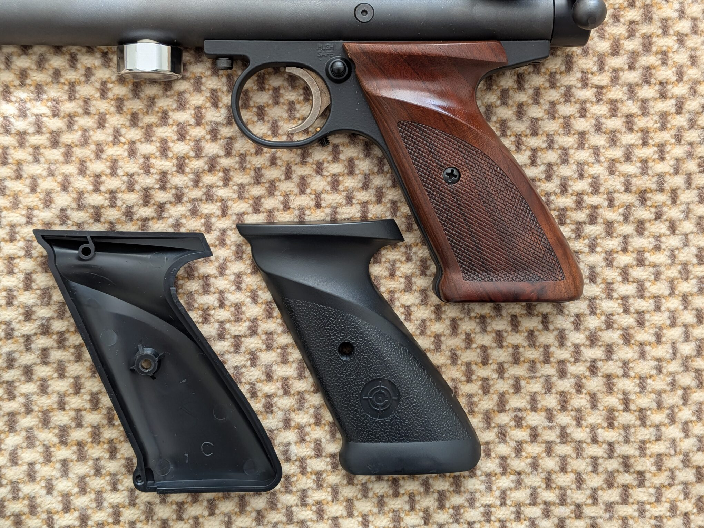

**The factory plastic grips feel cheap to me**. I can also feel a little **grip panel movement when cocking**. That's probably because the grip panels are thin and use a single screw each; I would prefer a more secure feel. I suggest to replace them with more solid aftermarket grips.

The grip feels comfortable in my hand. But for one-handed shooting, it might be a little thin and offers limited support at the base of my hand. For silhouette matches, I would therefore **prefer to use a two-handed hold**.

**The pistol feels very well balanced.** Most of the weight feels concentrated near the grip, with only a barely noticeable forward bias.

## Trigger and Sights

### Trigger

Crosman specifies a **two-stage adjustable drop-sear trigger**. My close-up shows the curved blade and the adjustment hardware around the trigger guard. [Crosman trigger description](https://www.crosman.com/product/crosman-1701p-silhouette-competition-pcp-air-pistol-177-caliber/).

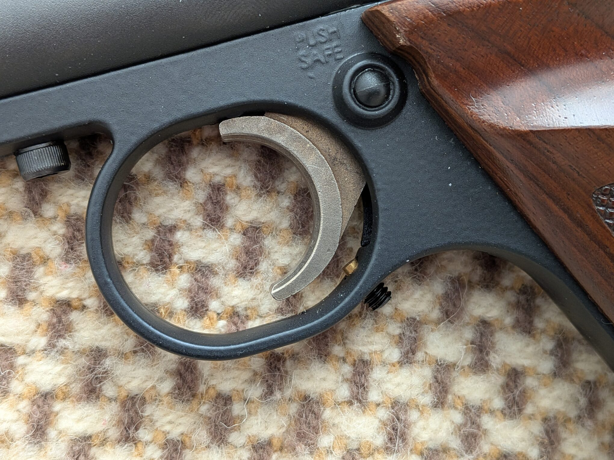

At the factory setting, the **pull feels quite light to me**. The **first stage is short**, followed by a clear wall marking the second stage. A little more pull fires the pistol, with **very little second-stage travel**, similar to my [HW45](/blog/hw45_intro/) and [HW75](/blog/hw75_intro/). Although the wall is easy to feel, the release is not quite as crisp as either Weihrauch's trigger to me. But overall it's a good trigger that contributes to the accuracy of the pistol.

The **overtravel screw** in the trigger guard acts as an adjustable stop, limiting how far the trigger continues moving after the shot releases. It lets the shooter reduce excess movement after the break for a more controlled follow-through.

### Williams Rear Sight

The 1701P **does NOT come with a rear sight from the factory**. I chose the [Crosman Williams rear sight](https://www.pyramydair.com/product/crosman-williams-rear-sight-notched-blade-elevation-windage-adj-3-8?a=2008) to keep the pistol lightweight and to enter silhouette competitions using open sights.

The Williams sight on mine has a plain rear notch, separate knurled adjustment knobs, and visible reference scales for elevation and windage.

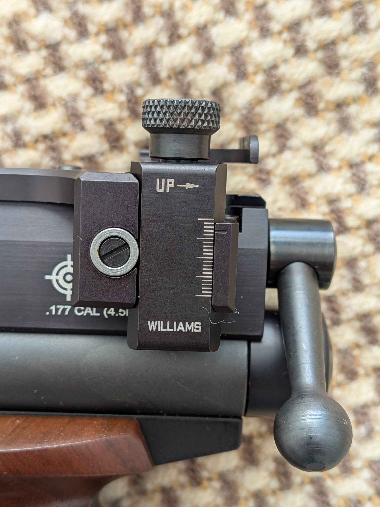

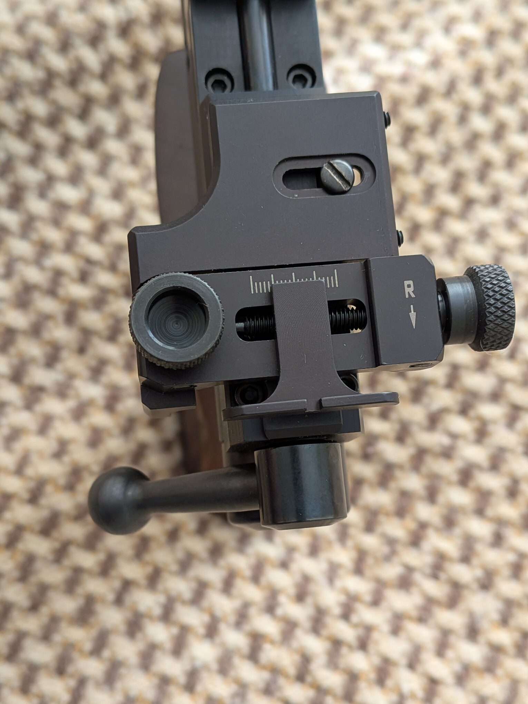

### Rotating Front Sight

The front blade can rotate to change its apparent width in the rear notch. The side set screw secures that adjustment, as described in the [manual's sight section](https://support.crosman.com/hc/en-us/article_attachments/201669374/1701P-515.pdf).

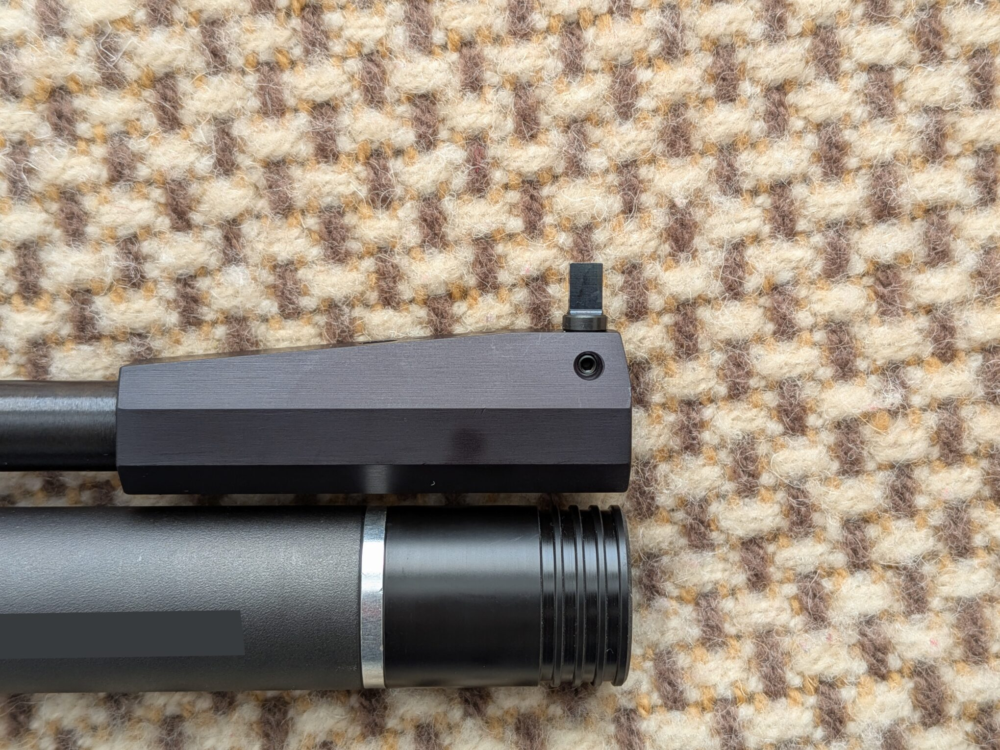

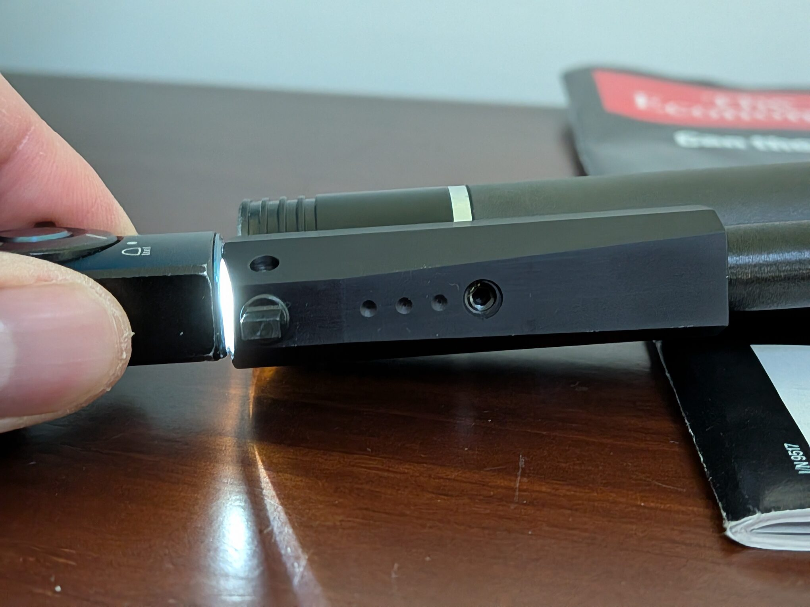

> **P.S.** I shone a flashlight into the muzzle opening and saw no light through the three small recesses on the front-sight housing. Their shallow appearance also suggests **dimples rather than gas ports**.

### Sight Picture and Aiming

The sight picture is **clear and easy to aim with.** I like the clean, plain front sight paired with the Williams rear sight for target shooting.

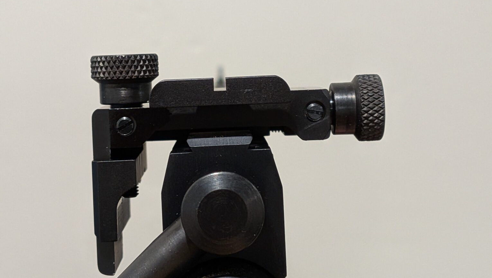

However, **the rear notch feels a little narrow to me**. For a rear sight costing me about $90+ extra, I would expect adjustable notch width so I could tailor the sight picture to my preference.

So far the sight holds its setting quite well. I will give update if I notice any issue over time.

## Loading and Shooting Experience

Loading is mostly smooth, and the bolt moves very smoothly. Occasionally, a pellet that is not properly aligned with the barrel entrance catches in the breech instead of feeding cleanly.

The photo below shows a loading failure I have encountered. When this happens, I have to guide the pellet head into the barrel entrance by hand, then push the bolt forward to seat the rest of the pellet. It is a small but recurring inconvenience that makes **careful pellet alignment important**.

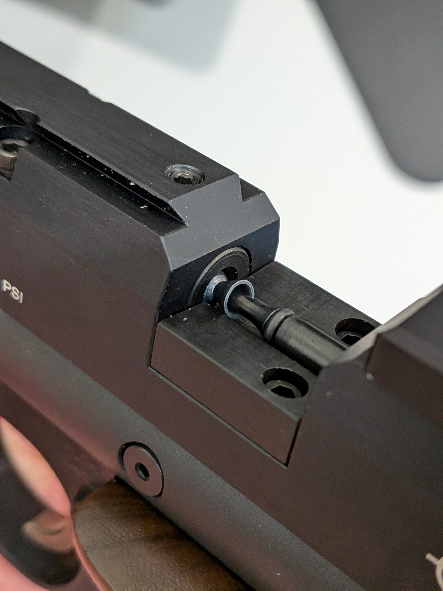

The manual crossbolt safety sits just behind the trigger. These two photographs show its two positions; the exposed red ring indicates off safe.

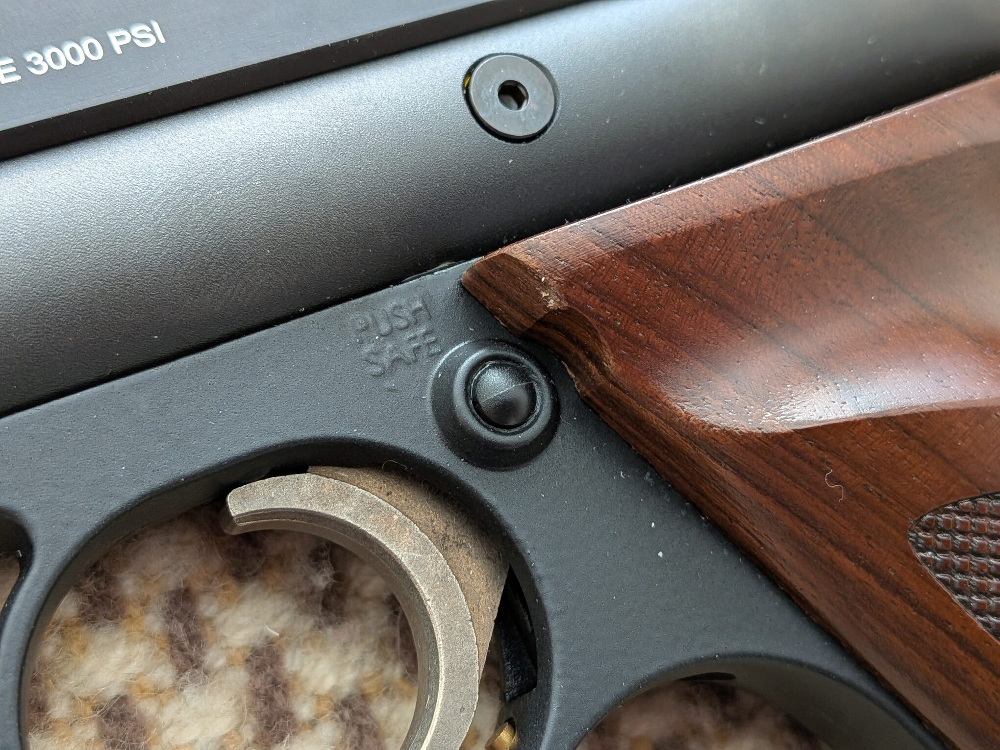

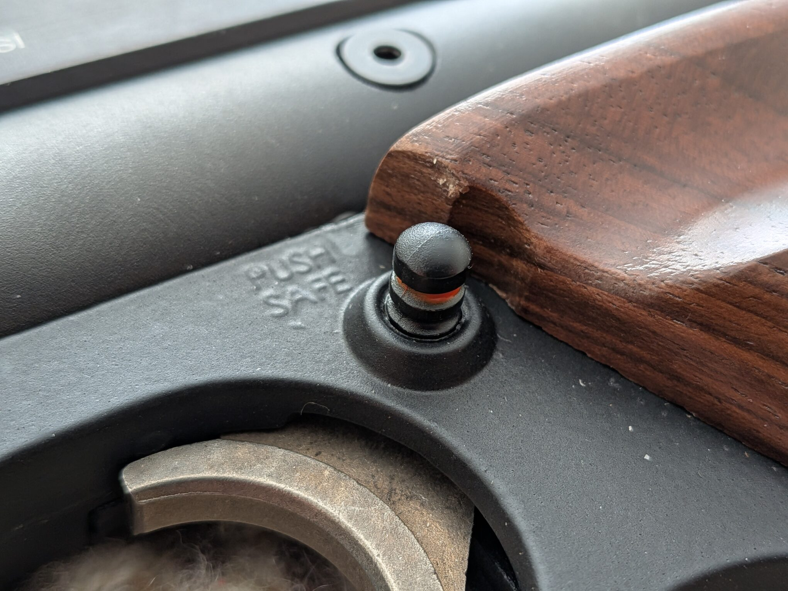

Shooting is very comfortable. The pistol feels **light to hold**, and I have not found holding it tiring during my sessions (72 shoots). I feel almost **no recoil**, and it shoots **very accurately** for me with [my preferred setup](#chronograph-results). It is also **very quiet**, probably one of the quietest airguns I own (on par with FAS 6004). That noise assessment is a personal impression, not a sound-level measurement yet.

## Chronograph Results

The result that matters most to me is the **consistent 32-shot run within this session: shots 21–52**. The first table summarizes all 72 shots; the [second table](#the-useful-result-32-consistent-shots) focuses on the useful pressure range and selected readings from that run.

### Full Session: All 72 Shots

My Garmin session records **72 shots** (starting from cold barrel) with JSB Exact 8.44gr pellets. These figures include shots outside the consistent run, so they describe the whole session rather than the consistency of shots 21–52 alone.

| Measurement | Full 72-shot session |
| --- | --- |
| Pellet | JSB Exact, 8.44 grains, .177 |
| Recorded shots | 72 |
| Average velocity | **444.2 fps** |
| Minimum velocity | 422.2 fps |
| Maximum velocity | 456.7 fps |
| Extreme spread | 34.5 fps |
| Standard deviation | 8.4 fps, as reported by Garmin |

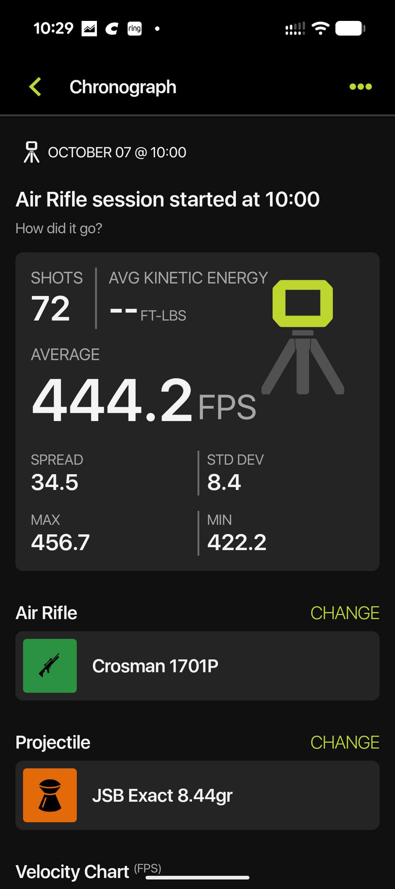

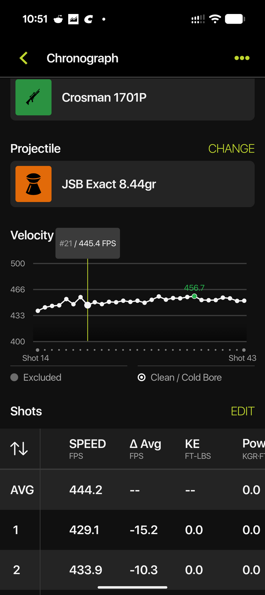

### The Useful Result: 32 Consistent Shots

**Shots 21–52 inclusive give me 32 consistent shots from one fill**, starting just above **2,250 psi** and ending at about **1,750 psi** with JSB Exact 8.44-grain pellets. This is the part of the session I find most useful for planning my shooting and refills.

The table below shows three checkpoints within that 32-shot run. Pressures are approximate gauge readings.

| Shot in session | Approx. air pressure | Velocity |
| --- | --- | --- |
| 21 — start | Just above 2,250 psi | 445.4 fps |
| 36 | 2,000 psi | 456.7 fps |
| 52 — end | 1,750 psi | 445.8 fps |

Repeated tests have given me similar results: roughly **32–34 useful shots per fill**. Around 32 consistent shots feels like plenty to me.

## My Verdict So Far

### What I Like

- **Clean shape.** The clean, uncomplicated profile appeals to me.
- **Balance in hand.** (TBD)
- **Accuracy with my preferred setup.** I am pleased with how it shoots using JSB Exact 8.44-grain pellets in the pressure range that has worked well for me.
- **Quiet shooting.** Its report is very quiet to my ears and suits backyard setup.
- **Useful shot count.** Roughly 32 consistent shots from one fill gives me plenty of shooting between refills.
- **Downward-facing pressure gauge.** I can read it from underneath the pistol without putting my face in front of the muzzle.

### What I Don't Like

- **A little bit pricey without a rear sight.** (TBD)
- **Coarse pressure-gauge markings.** There are no intermediate marks between every 500 psi, making it difficult to read the pressure precisely.
- **Pellets sometimes catch during loading.** If a pellet is misaligned, it can get stuck in the breech. I then have to guide the pellet head into the barrel entrance by hand before pushing the bolt forward to seat it fully.
- **Factory grip material.** The plastic panels feel cheap to me.
- **Slight grip movement.** With the single-screw panel mounting, I can feel a little movement when cocking. I would prefer a second screw on each panel for a firmer fit.

So far, the quiet report and useful run of consistent shots are the strongest practical positives for me. Loading and grip security are the main but minimal annoyances. I will add more impressions as I spend more time with the pistol, along with measured target results and a fuller account of the trigger and balance.
