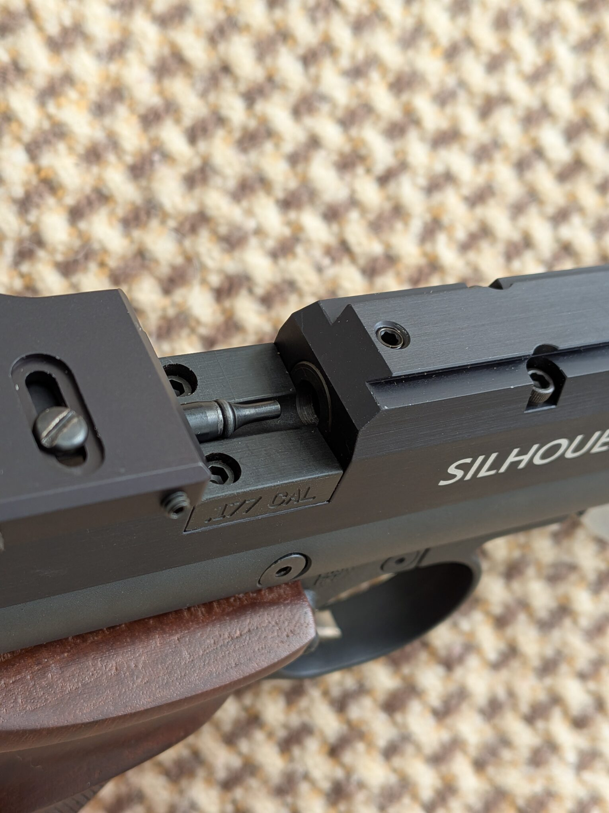

> **Working draft:** These are my impressions so far. Measured target groups and further handling notes are still to come; TBD notes mark the remaining gaps.

## A Brief Introduction

The Crosman 1701P Silhouette has a long, slim profile: an exposed barrel above the air reservoir, a compact grip below, and a bolt at the back of the breech. My example wears checkered wooden grips and a Williams rear sight. Those two additions give it a different appearance from the basic black-gripped pistol.

What I like most is its **simple shape, very quiet report, and accuracy with the setup that works well for me**. With JSB Exact 8.44-grain pellets and a starting fill of roughly **2,225–2,500 psi**, my tests have given me about **32–34 shots around 445–455 fps**. Getting roughly 32 consistent shots from one fill is a real positive for me. Loading takes care, though, and the grip is one area I would improve.

**TBD — ownership context:** How long I have owned it, why I chose it, and my main use for it.

## Appearance and Build

I like the 1701P's simple shape. Its two parallel tubes and angular breech give it a clean, uncomplicated profile. The barrel extends well forward of the hand, ending in a substantial front-sight housing. A pressure gauge projects below the reservoir, just ahead of the trigger guard.

The close-ups show the different surface finishes clearly: fine machining lines on the breech and sight housing, a textured reservoir, and the curved silver-colored trigger against the dark frame. The wooden grips provide the strongest visual contrast.

The factory plastic grips feel cheap to me. I can also feel a little grip movement when cocking, which detracts from the otherwise simple, purposeful design.

## Key Features and My Setup

Crosman describes the 1701P as a **.177, single-shot, bolt-action PCP pistol** with a Lothar Walther barrel and a reversible bolt. Its listed overall length is 14.75 inches, with a product weight of 2.8 lb; that is a factory specification, not a weighing of my equipped pistol. See the [Crosman product specifications](https://www.crosman.com/product/crosman-1701p-silhouette-competition-pcp-air-pistol-177-caliber/).

My photographed setup has wooden grip panels, a Williams adjustable rear sight, and the bolt handle on the left side. The exact grip maker and rear-sight model are **TBD**.

### Filling and the Pressure Gauge

The fill connection sits beneath a removable cap at the front of the reservoir. The gauge is underneath the pistol rather than at the end of the tube.

The [owner's manual](https://support.crosman.com/hc/en-us/article_attachments/201669374/1701P-515.pdf) specifies a **3,000 psi maximum fill pressure** and a Foster #12FS or #12FSS quick-disconnect connection. The appropriate working fill depends on the pistol's tune. The gauge photograph is a separate detail view, not a record of the chronograph session's starting pressure.

In my tests, starting fills of roughly **2,225–2,500 psi** have worked well with JSB Exact 8.44-grain pellets, giving about **32–34 consistent shots around 445–455 fps**. These are my results with this pistol and setup.

**TBD — filling details:** My pump or tank setup and the pressure at the end of the useful string.

## Grip, Ergonomics, and Balance

The wooden grips have checkered panels and a pronounced ledge near the top. The photograph below places them beside the black synthetic panels, showing the difference in surface texture and construction.

The factory plastic panels are one of my least favorite parts of the pistol. The grip panels use a single screw each, and I can feel a small amount of grip movement when cocking. I would prefer a more secure feel.

**TBD — personal fit:** Grip size and comfort, trigger reach, balance in a one-handed hold, fatigue during longer sessions, and whether the wooden panels improve on the synthetic ones for me.

## Trigger and Sights

### Trigger

Crosman specifies a **two-stage adjustable drop-sear trigger**. My close-up shows the curved blade and the adjustment hardware around the trigger guard. That describes the hardware; the feel of the stages and release still needs my firsthand account. [Crosman trigger description](https://www.crosman.com/product/crosman-1701p-silhouette-competition-pcp-air-pistol-177-caliber/).

**TBD — trigger impressions:** First-stage travel, second-stage definition, creep, break, overtravel, and reset. Measured pull weight and any changes from the received setting are also pending.

### Williams Rear Sight

The Williams sight on mine has a plain rear notch, separate knurled adjustment knobs, and visible reference scales for elevation and windage.

The rear sight is an addition to the base pistol: the [Crosman manual](https://support.crosman.com/hc/en-us/article_attachments/201669374/1701P-515.pdf) states that one is not included and documents both Williams and LPA mounting options.

### Rotating Front Sight

The front blade can rotate to change its apparent width in the rear notch. The side set screw secures that adjustment, as described in the [manual's sight section](https://support.crosman.com/hc/en-us/article_attachments/201669374/1701P-515.pdf).

The second photograph also records the three dimples on the housing. Their purpose has not been confirmed for this draft.

**TBD — sight picture:** My preferred blade width, visibility in my usual lighting, adjustment feel, and whether the sight holds its setting.

## Loading and Shooting Experience

The open breech exposes the loading trough and pellet probe. **Loading needs attention:** I have to guide the pellet head into the barrel entrance so it does not get caught in the breech when I close the bolt. It is a small detail, but one I need to get right on every shot.

The manual crossbolt safety sits just behind the trigger. These two photographs show its two positions; the exposed red ring indicates **off safe**, according to the [owner's manual](https://support.crosman.com/hc/en-us/article_attachments/201669374/1701P-515.pdf).

The 1701P is **very quiet to my ears**, and I find its noise level friendly to backyard shooting in my setup. That is a personal impression, not a sound-level measurement.

**TBD — further shooting impressions:** Bolt effort, shooting rhythm, and movement on firing.

## Chronograph Results

My Garmin session dated **October 7, 2026** records **72 shots** with the projectile labeled **JSB Exact 8.44gr**. The device screen and app summary agree on the figures below.

| Measurement | Session result |
| --- | --- |
| Pellet | JSB Exact, 8.44 grains, .177 |
| Recorded shots | 72 |
| Average velocity | **444.2 fps** |
| Minimum velocity | 422.2 fps |
| Maximum velocity | 456.7 fps |
| Extreme spread | 34.5 fps |
| Standard deviation | 8.4 fps, as reported by Garmin |

The second screenshot displays **shots 14–43, a 30-shot portion of the session**, rather than the full string. That visible portion sits mostly around the mid-440s to mid-450s fps. The selected point is shot 21 at 445.4 fps. The table beneath the chart also shows the first two readings, 429.1 and 433.9 fps.

### The Useful Shot String

For my use, the more useful result is the roughly **32–34 shots around 445–455 fps** that I get with JSB Exact 8.44-grain pellets when starting at about **2,225–2,500 psi**. I identified **shots 21–52 inclusive — 32 shots —** as a consistent run in my testing. Around 32 consistent shots from one fill feels like plenty to me.

These pressure and velocity ranges summarize my testing notes. The supplied chart view ends at shot 43, so it does not show all of the reported 21–52 run. Its visible peak of 456.7 fps also means **445–455 fps is an approximate description**, not a strict cutoff verified for every shot. The complete readings are needed to calculate that subset's exact average, spread, and SD.

The **72-shot session summary** above includes a wider range of velocities, with a full-session spread of approximately **7.8% of the average**. It should be read separately from my useful-shot count per fill.

The SD above is transcribed from Garmin; the screenshots do not identify whether it uses a sample or population calculation. Energy is left unreported because the app displays no energy result; an estimate from pellet weight and average velocity would be a separate calculation.

**TBD — test conditions:** Exact starting and ending pressures for the pictured 72-shot session, whether any refill or setting change occurred within it, temperature, chronograph placement, and any excluded readings.

## Accuracy

In my shooting, the 1701P has been **very accurate with the setup that works well for me**: JSB Exact 8.44-grain pellets and the fill range described above. That is my firsthand impression from shooting it; the chronograph numbers describe velocity consistency separately.

**TBD — measured target results:** Distance, shooting position, target photographs, and group measurements are still to be added. I have not documented a comparison with other pellets here.

The accuracy update should record distance, shooting position and support, pellet model and weight, shots per group, and center-to-center group size. Several groups with each pellet or setup will make the comparison more useful than a single best target.

## Ownership and Value

The setup includes more than the pistol itself: the rear sight, wooden grips, and a source of compressed air all belong in the ownership picture.

**TBD — ownership notes:** Reliability, pressure retention during storage, maintenance so far, and any accessory costs worth including. A value comparison with my other pistols should explain what the 1701P adds to my shooting, once those impressions are recorded.

## My Verdict So Far

### What I Like

- **Simple shape.** The clean, uncomplicated profile appeals to me.
- **Quiet shooting.** Its report is very quiet to my ears and suits my backyard setup.
- **Accuracy with my preferred setup.** I am pleased with how it shoots using JSB Exact 8.44-grain pellets in the pressure range that has worked well for me.
- **Useful shot count.** Roughly 32 consistent shots from one fill gives me plenty of shooting between refills.

### What I Don't Like

- **Loading needs care.** I have to guide the pellet head into the barrel entrance to keep it from catching in the breech.
- **Factory grip material.** The plastic panels feel cheap to me.
- **Slight grip movement.** With the single-screw panel mounting, I can feel a little movement when cocking.

So far, the quiet report and useful run of consistent shots are the strongest practical positives for me. Loading and grip security are the main annoyances. I will add more impressions as I spend more time with the pistol, along with measured target results and a fuller account of the trigger and balance.
