## A Brief Introduction

HW40 was not in my favorite list at first. Its appearance and plastic exterior gave me a toy-like impression, and I even considered selling it while keeping my HW45 and HW75. However, the more I shot it, the more I enjoyed it. Its accuracy, trigger, and overall shooting experience feel at least as good as my HW75's, and in some respects better. The construction feels solid in use, and its low weight makes it easy to hold without much fatigue.

My 25-shot chronograph string averaged 426.5 fps with Meisterkugeln 7-grain pellets, with just 7.3 fps spread and **only 2.0 fps STD DEV** (better than my HW75!). That supports its excellent velocity consistency.

## First Impressions

### Compact Shape and Polymer Build

The black polymer exterior gives the HW40 a very different appearance from the metalwork and wood grips of my HW45 and HW75. The squared upper assembly resembles a pistol slide, but hinges forward to expose the compression mechanism and barrel breech.

Despite the plastic main frame, **the construction feels solid**. Visually, I think the design could be more refined. That is a matter of taste, separate from how well it is put together.

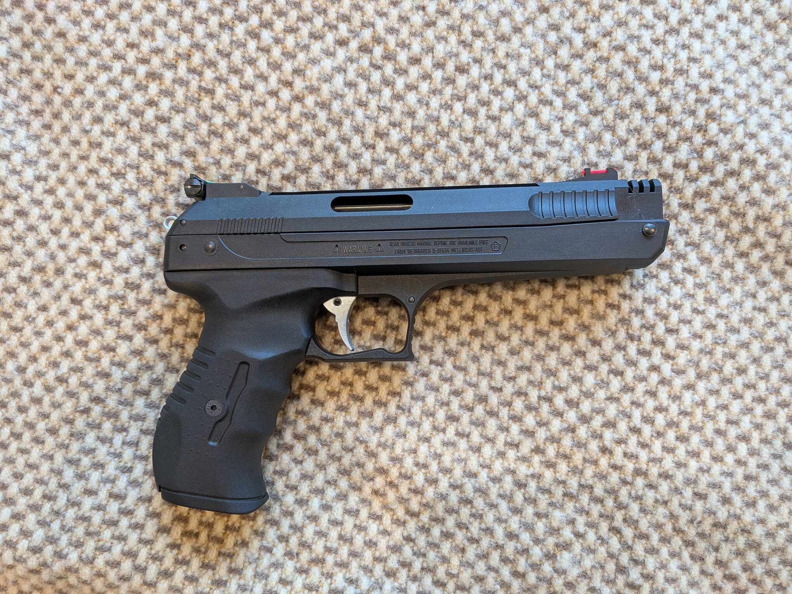

It is marked **.177 / 4.5 mm** and wears open sights. [Weihrauch lists](https://www.weihrauch-sport.de/air-pistols/hw-40-pca?lang=en) a weight of 780 g, overall length of 240 mm, and barrel length of 170 mm.

### Grip and Balance

The molded grip has shallow finger grooves and no adjustable palm shelf. Weihrauch describes it as suitable for either hand. The photo below shows the grip proportions and the upward curve where the trigger guard meets the middle finger.

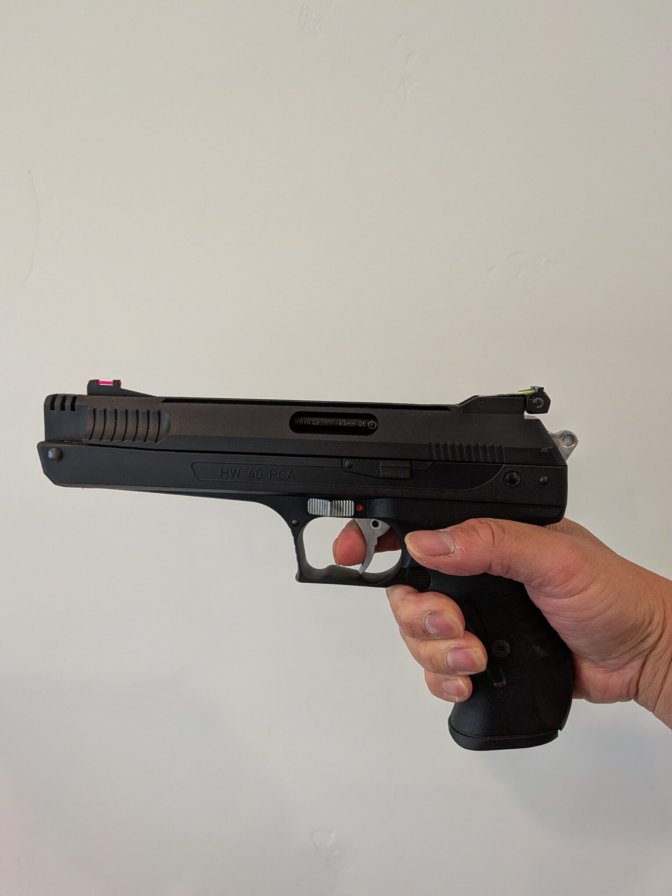

For my hand, **the grip feels a little bit plain and thin**. As the photo shows, there is a noticeable gap between the lower part of the grip and my palm. I would like more shape and support to help me settle into the same hold each time. That could be a weak point in precision shooting, where a repeatable grip matters throughout a string of shots. However, a rubber grip sleeve or grip putty could add thickness and contour. These are possibilities to explore.

The pistol feels **well balanced** in my hand, neither muzzle-heavy nor rear-heavy. The low weight also makes handling less tiring for me. The barrel still sits higher above my hand than I would like, a complaint I also have with my other Weihrauch pistols.

I also find the light body more sensitive to my own movements. It is easier to hold up, but keeping the sights settled still takes care. This is my handling impression, rather than a measured comparison of hold stability.

## Trigger and Sights

### A Trigger I Have Come to Appreciate

Weihrauch confirms that the HW40 has a **[two-stage trigger](https://www.weihrauch-sport.de/air-pistols/hw-40-pca?lang=en)**. Its curved silver-colored blade and adjustment screw stand out against the black frame. In use, I enjoy it at least as much as the trigger on my HW75.

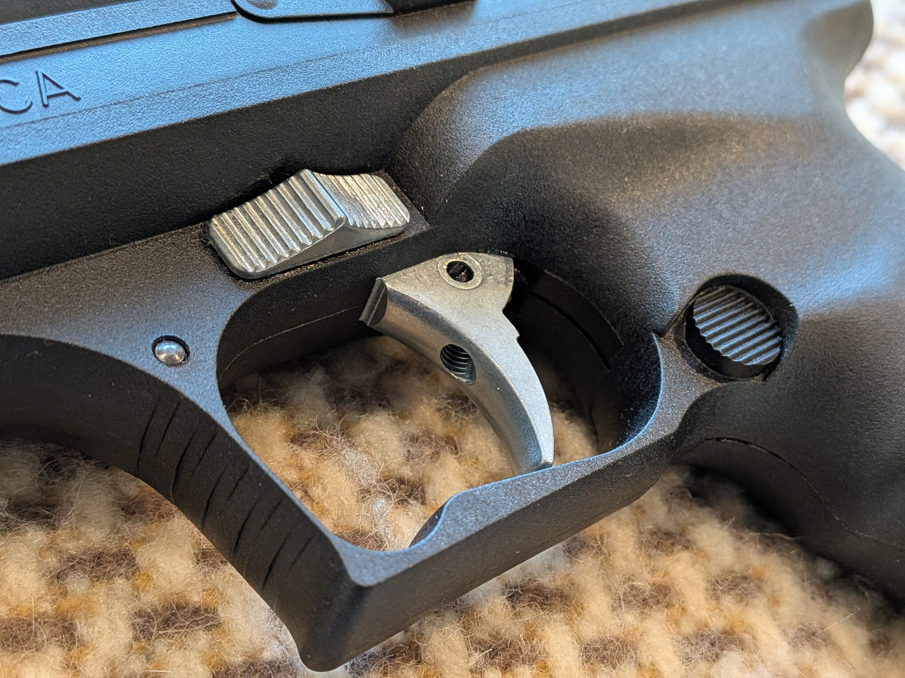

Trigger feel is a recurring positive in [this HW40 owner discussion](https://airgunforums.co.uk/threads/weihrauch-hw40-pistol-review.650/). In July 2025, an owner who had shot both the HW40 and Beeman P17 described the HW40's crisper, lighter release as the deciding difference for him.

According to the [HW40 manual](https://www.weihrauch-sport.de/wp-content/uploads/2016/01/HW-40-de-fr.engl_..pdf#page=25), adjustment screw **(a)** changes the let-off travel: counterclockwise shortens it, clockwise lengthens it. Weihrauch recommends retaining the factory setting or having a qualified airgunsmith make adjustments.

### Fiber-Optic Sights

The front sight carries a red insert, with two green dots at the rear. The rear sight adjusts for windage and elevation, and Weihrauch specifies an **11 mm dovetail** for an optic.

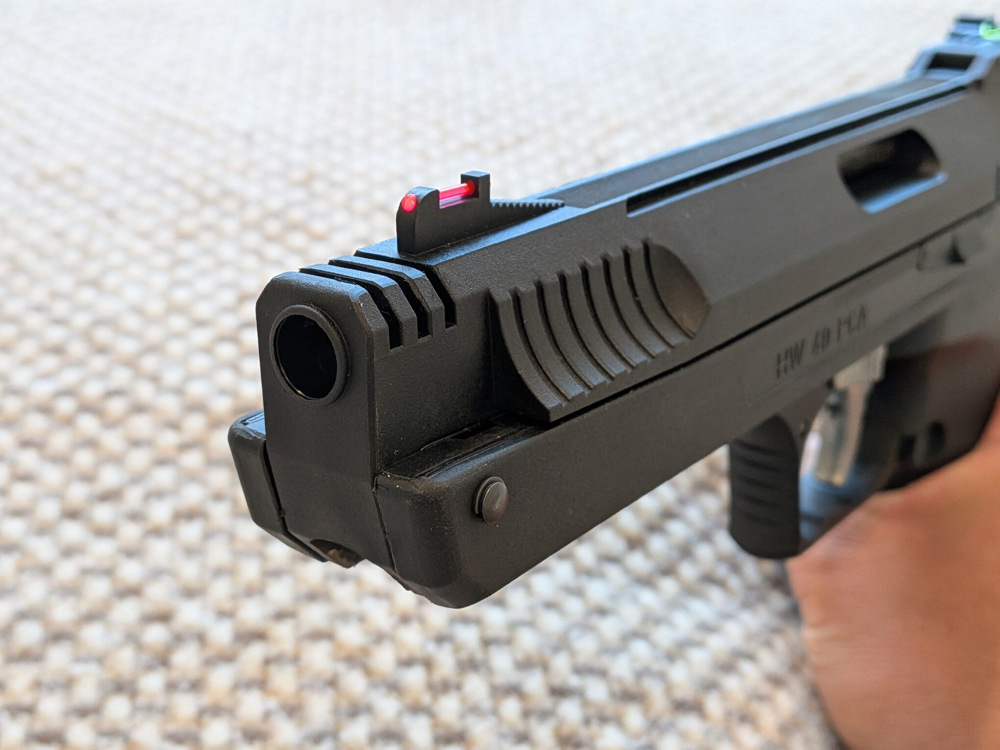

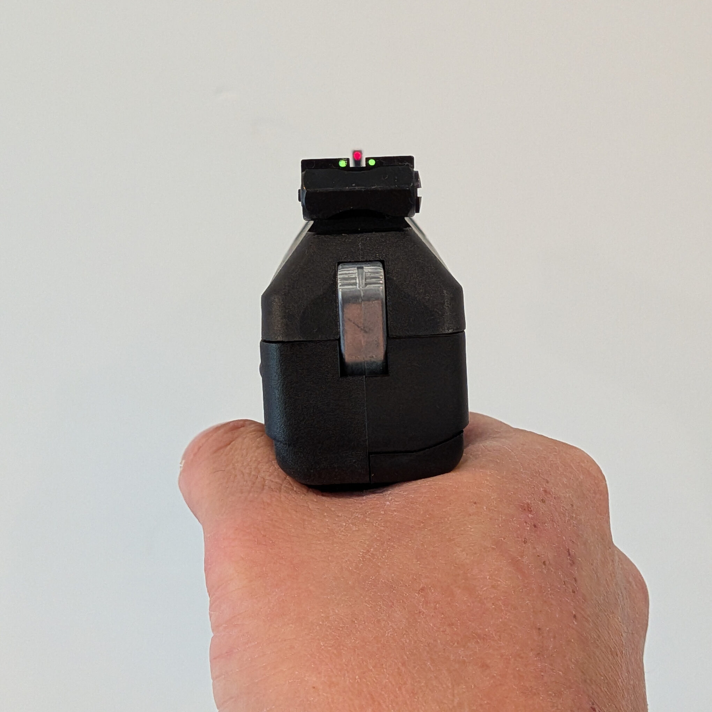

The fiber-optic dots make the sights easy to pick up for recreational shooting. For 10-meter-style target shooting, however, I find them less helpful -- when I concentrate on aligning the front blade in the rear notch, the red dot appears offset toward the right side of the front blade in my view. I do not know what causes that appearance, but it distracts from the precise sight picture I want.

For me, these sights suit recreational shooting and target practice better than dedicated competition shooting. Their visibility can be an advantage or a drawback, depending on how I am aiming.

The exposed front insert also deserves care. I broke the similar insert on my HW45 when it struck a table; the HW40 insert shown here remains intact.

## Shooting Experience

### Cocking Effort and Loading Access

The hammer-shaped rear latch releases the upper assembly. Opening it exposes the barrel breech; closing it compresses the air for the next shot. The [manual's operating instructions](https://www.weihrauch-sport.de/wp-content/uploads/2016/01/HW-40-de-fr.engl_..pdf#page=13) explain this sequence and the increased resistance during closing.

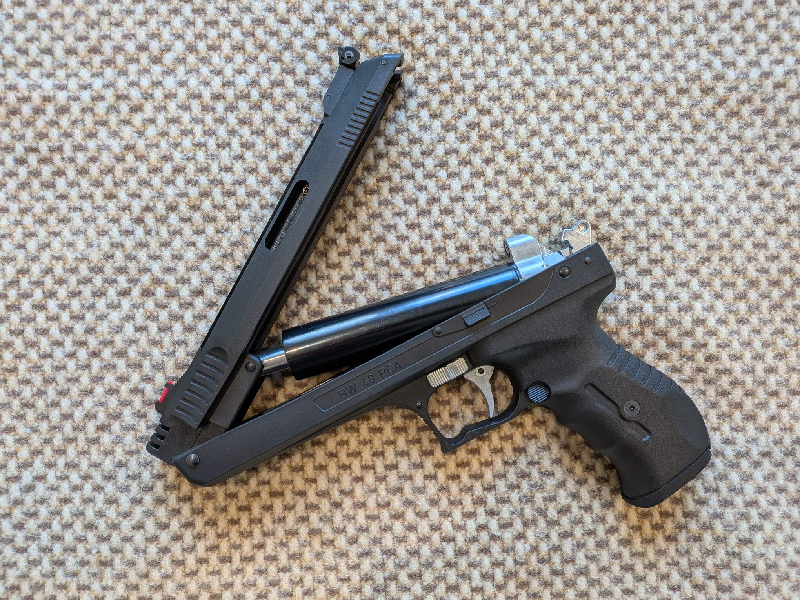

The build quality feels excellent. When I open and close the upper frame, there is **zero wobble or unexpected movement**. It feels steady and as solid as my all-metal HW75, despite the HW40's plastic frame.

This is the practical tradeoff of the self-contained action: each shot requires a compression stroke and a separately loaded pellet. Owners in the [HW40 forum thread](https://airgunforums.co.uk/threads/weihrauch-hw40-pistol-review.650/) report firm closing effort and the possibility of pinching skin as the action shuts. The manual also calls for keeping fingers and clothing clear during operation.

For me, **the final push to close the upper frame is heavy relative to the pistol's power and light weight**. It feels noticeably stiffer and requires more effort than closing my HW75, which feels much softer and smoother through this part of the stroke. This is a comparison of feel; I have not measured the closing force.

The 11 mm dovetail has **sharp edges** that press painfully into my palm during cocking. This adds to the discomfort of the heavy final closing stroke.

The pellet enters the breech beneath the raised upper assembly. The close-up shows how the surrounding housing limits the space around the barrel opening.

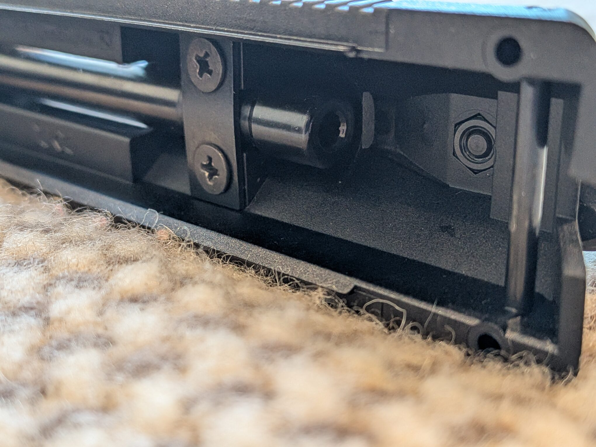

The barrel feels very well made, with the same premium quality I appreciate in my HW75. **Seating pellets feels very smooth and consistent**, which makes this part of the loading routine satisfying.

### Automatic Safety

The safety engages automatically **every time the pistol is cocked**. The rearward position covers the red mark; moving the slider forward exposes it, as shown below. The positions and operation are illustrated in the [manual](https://www.weihrauch-sport.de/wp-content/uploads/2016/01/HW-40-de-fr.engl_..pdf#page=25).

I find having to disengage it before every shot an extra, repetitive step in the shooting routine. Other shooters may appreciate the automatic engagement, so whether it feels helpful or cumbersome is a matter of preference.

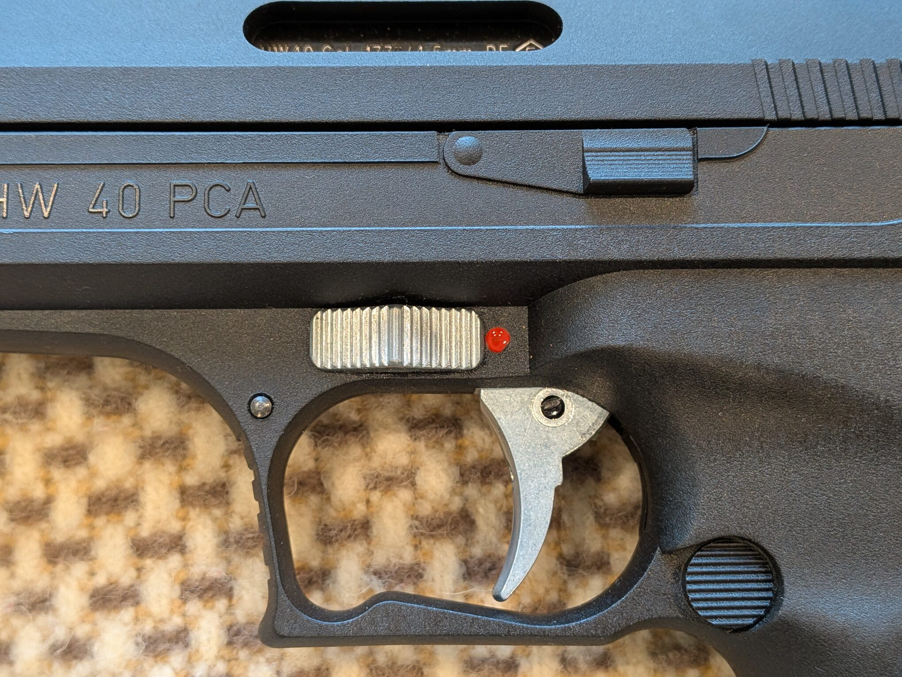

### A Smooth Firing Cycle

In my earlier [HW45](/blog/hw45_intro/) and [HW75](/blog/hw75_intro/) reviews, I described the HW40 as smoother in firing. The HW45 produces much stronger mechanical vibration, and I also notice more vibration from my HW75 than from the HW40. Those are impressions from shooting these pistols, not instrumented recoil measurements.

## Chronograph Results

I used a Garmin C1 chronograph for this 25-shot string with Meisterkugeln 7-grain pellets.

| Measurement | Result |
| --- | --- |
| Pellet | Meisterkugeln, 7 gr nominal |
| Shot range | 1–25; 25 shots |
| Average velocity | **426.5 fps** |
| Minimum–maximum | 423.0–430.3 fps |
| Extreme spread | **7.3 fps** |
| Standard deviation | **2.0 fps** |
| Calculated energy at average velocity | Approximately 2.83 ft-lb / 3.83 J |

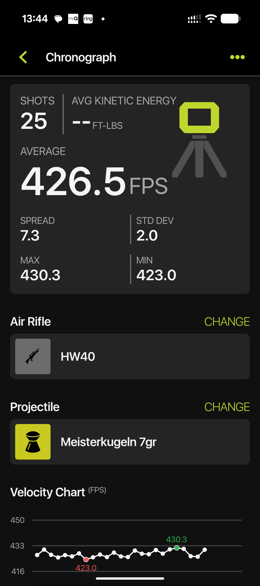

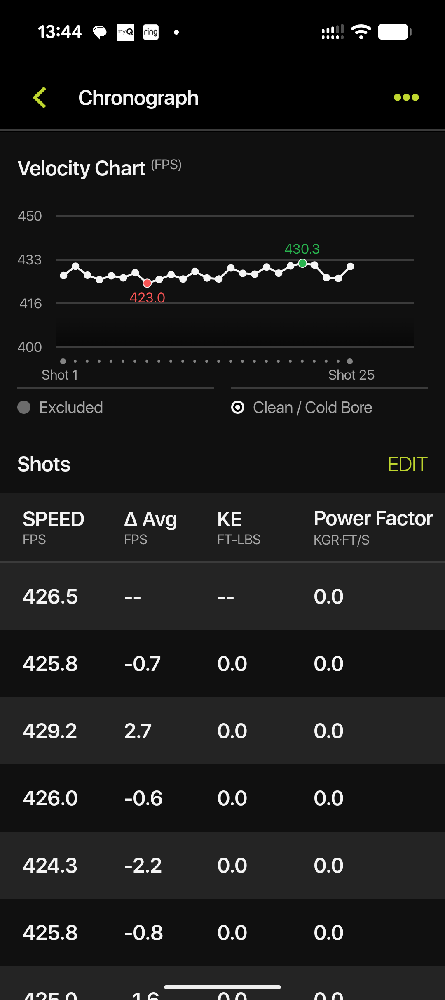

With a **standard deviation of only 2.0 fps**, the HW40 delivered excellent shot-to-shot velocity consistency in this 25-shot string. That is less than 0.5% of its average velocity. It does not establish group size or pellet preference; those need target testing.

## HW40 Compared with the HW75

Both are single-stroke pneumatic pistols, but they feel quite different in use. The HW40 is compact and light, while the HW75's metal frame and walnut grip give it the more substantial feel I described in my [HW75 review](/blog/hw75_intro/).

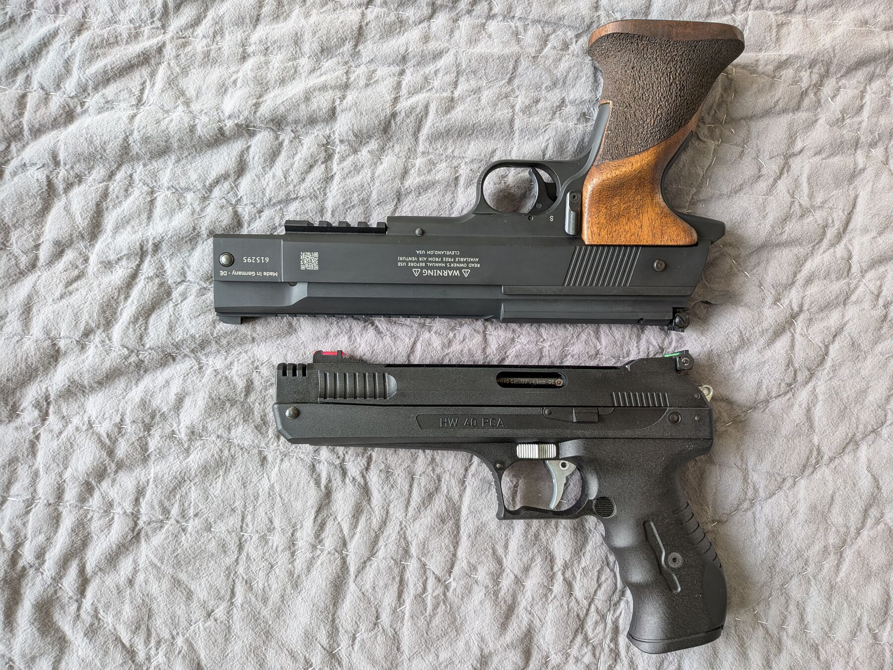

Weihrauch lists the [HW40](https://www.weihrauch-sport.de/air-pistols/hw-40-pca?lang=en) at **780 g and 240 mm long**, and the [HW75](https://www.weihrauch-sport.de/air-pistols/hw-75?lang=en) at **1,060 g and 280 mm long**. The HW40 is therefore 280 g lighter and 40 mm shorter by the published specifications; both have a listed 170 mm barrel.

### Handling and Grip Fit

| Detail | HW40 | HW75 |
| --- | --- | --- |
| Closing effort, in my experience | Stiffer final push | Softer, smoother closing stroke |
| Firing feel, in my experience | Smoother, with less noticeable vibration | More noticeable mechanical vibration |
| Grip fit for my hand | Plain and thin; I would like more contour and support | Textured walnut, but still slim around the thumb–index web |
| Shooting routine | Safety engages automatically with each cocking cycle | Separate hammer cocking and manual safety |

The HW75's more sculpted grip does not automatically mean a better fit for me. Its flat trigger-guard undercut leaves much of the weight on my middle finger, while the HW40 curves upward at that point. The photos show the HW75 on the left and HW40 on the right, with arrows marking this contact area.

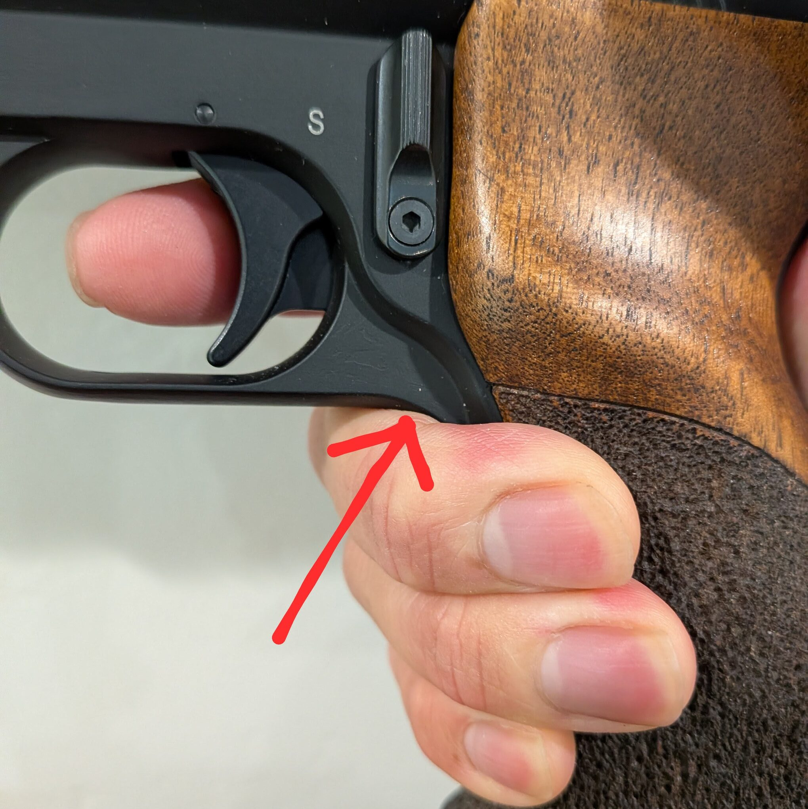

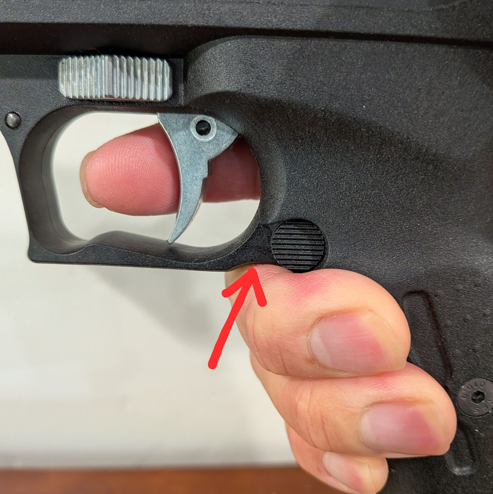

Both pistols still place the barrel higher above my hand than I prefer. The HW40 reduces holding fatigue, but its light weight and simple grip do not give me all the steadiness and support I would want for competition.

### Chronograph Comparison

These are the complete 25-shot strings from separate sessions, both using Meisterkugeln 7-grain pellets. The HW75 figures come from my [earlier chronograph results](/blog/hw75_intro/#muzzle-velocity), including its initial cold-bore shots.

| Measurement | HW40, shots 1–25 | HW75, shots 1–25 |
| --- | --- | --- |
| Average velocity | **426.5 fps** | **430.1 fps** |
| Minimum–maximum | 423.0–430.3 fps | 421.8–434.7 fps |
| Extreme spread | **7.3 fps** | **12.9 fps** |
| Standard deviation | 2.0 fps | 3.50 fps, population |

The recorded averages differ by just **3.6 fps**, and the **HW40 had the smaller extreme spread** in these sessions. The HW75 settled after its early shots: its separately reported shots 8–25 averaged 431.6 fps with a 9.9 fps spread. The table retains the full string for both pistols.

The HW40 chart shows no obvious early settling period like the one in my HW75 string. Based on this recorded session, the HW40 did not appear to need warm-up shots to produce consistent velocity. This describes the pattern in these results; it may not establish that either pistol will behave the same way in every session.

From those test results, the HW40 showed better velocity consistency in these recorded strings, but repeated tests under the same conditions would be needed to establish whether that advantage holds. These results do not show which pistol shoots tighter groups, but it's also an indicator that HW40 can be as accurate / consistent as HW75. Be aware that HW75 costs twice as HW40 ($600+ vs $300+ as of 2026).

## Ownership and Reliability

The compression mechanism and its seals are easy to see with the action open. The photos below show the piston linkage and the seal around the air outlet where it meets the barrel breech.

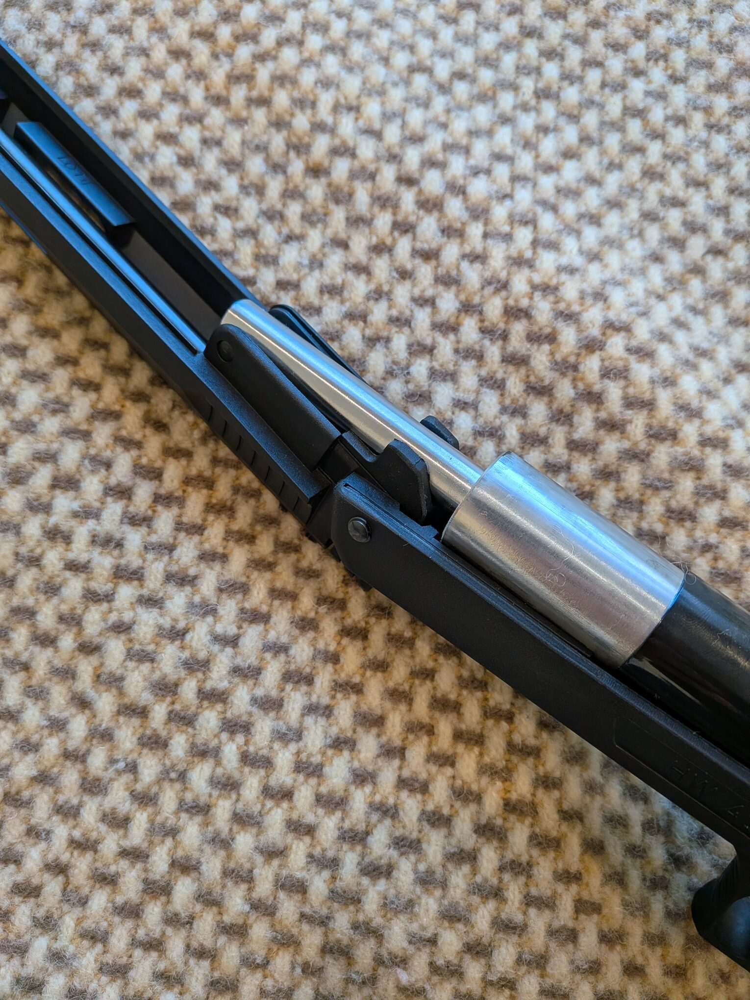

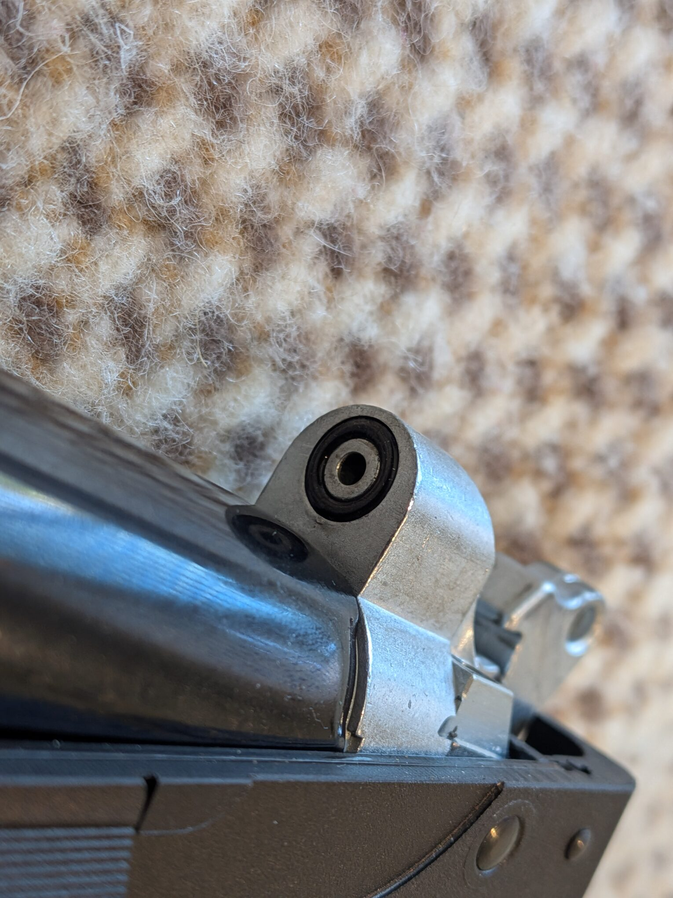

## My Take So Far

The HW40 has grown on me enough to change which pistol I would choose. Today, if I had to pick from my HW40, HW70A, HW45, and HW75 for a competition today, I would probably choose the HW40, even over the HW75. Its consistency, trigger, and shooting feel matter more to me now than the appearance that initially put me off.

My reservations about the thin grip and fiber-optic sight picture remain, especially for dedicated competition shooting. Even with those limitations, the HW40 would now be my likely choice among these four. That is my preference from shooting them; measured target comparisons are still to come.

### What I Like

- Very accurate in my shooting experience. The gun can shoot very consistently without warm-up.
- Excellent velocity consistency in the recorded 25-shot string.
- Solid construction despite the polymer main frame.
- Light weight that reduces handling fatigue, with neither a muzzle-heavy nor rear-heavy balance.
- A barrel that feels as well made as my HW75's, with smooth, consistent pellet seating.
- A trigger I enjoy as much as my HW75's.
- Fiber-optic sights that are easy to pick up for recreational shooting.

### What I Dislike

- I think the visual design could be more refined.
- The barrel sits higher above my hand than I would like.
- The grip feels plain and thin for the support I would want in competition.
- The light body feels more sensitive to my movements, making steady aiming more demanding.
- The final closing stroke feels heavy for its power and weight, and noticeably stiffer than my HW75.
- Sharp edges on the 11 mm dovetail press painfully into my palm during cocking.
- The red front dot appears offset to my eye during precise aiming, making these sights a poor fit for my 10-meter-style shooting.
- Disengaging the automatic safety before every shot feels repetitive to me.

To me, the HW40 delivers the accuracy, trigger, and shooting enjoyment I value in the HW75, sometimes even surpassing it, behind an exterior that still looks rather toy-like to my eye. It took time behind the sights for me to appreciate how much it offers.
